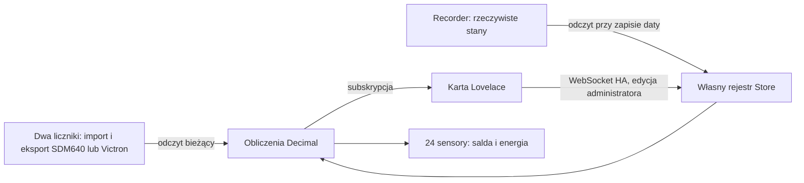

Aktualizacja 0.17.0: `BatteryEstimate.seed` odtwarza ciągły fragment kierunku mocy z istniejących klatek historii; nowsze próbki na żywo pozostają zachowane. Estymacja nie korzysta z nieznanych źródeł ani nie przenosi średniej przez zmianę kierunku. Wynik udostępnia faktyczne/wybrane okno, SOC, energię rezerwy, dodatkowy/łączny czas do 0% oraz 20 jawnych zakresów profilu. Ścieżka zapisu konfiguracji i format profilu BMS nie zmieniły się. Dialog baterii ma stabilny węzeł DOM i stan otwarcia niezależny od odświeżania klatek. Informacyjne hints w konfiguratorze korzystają z title, a nie details. Podgląd profilu aktualizuje wyłącznie swój fragment, zachowując formularz. Koordynator rejestruje zadanie zamknięcia HA, wstrzymuje nowe odświeżenia i czeka na aktywne odczyty przed zatrzymaniem Recorder.

Aktualizacja 0.16.0: `recovery.py` przechowuje źródła, trwałą ostatnią parę liczników, dowody początku/końca przerw i surowe odczyty graniczne. Nakładki rozliczenia są odbudowywane z dowodów, nie importowane jako zaufane kwoty. `HourBook` wyklucza nakładające się zwykłe godziny w zakresie nakładki i emituje znane fragmenty oraz jeden zachowawczy wpis na przerwę. Nie tworzy godzinowych rozkładów przyrostów. Rzeczywiste granice Recorder, zgodne sumy i kompletna historia mogą zastąpić nakładkę zwykłymi godzinami; samo spóźnione sumowanie nie wystarcza. `recovery_cache` jest opcjonalnym polem Store i JSON formatu 5, zapisywanym pod tym samym lockiem co rejestr. Nieudany zapis nie zmienia aktywnego stanu; zamknięcie integracji czeka na zakończenie punktu kontrolnego. Konflikt przerwy z datą faktury blokuje odtworzenie salda, zamiast podwajać energię. Dane wcześniejsze bez dowodów pozostają nieznane.

Aktualizacja 0.15.1: `energy_statistics.balanced_total` sumuje dostępne przyrosty osobno dla każdego fizycznego licznika w zadanym okresie; nie przecina ich znaczników czasu. Brak całej historii wymaganego licznika daje None. Wynik przenosi metadane pokrycia na obie karty. Zapytania graniczne pobierają też dwie poprzednie doby statystyk, aby zachować rzeczywisty odczyt sprzed nocnej przerwy PV; bez niego dostępny późniejszy zakres pozostaje częściowy. To wyłącznie widok fizycznej energii: finansowy `hourly.py` nadal wymaga kompletnych granic godzin i nie stosuje tego uzupełnienia.

Aktualizacja 0.15.0: `view_history.py` odtwarza bufory mocy z ostatnich 30 minut Recorder i opcjonalny profil ładowania z ostatnich 7 dni. Odczyty działają w executorze Recorder; obliczenia w executorze poza pętlą HA. Bufory widoku są rozdzielone od rozliczeń kWh. `AlignedFlow` dostarcza obu kartom tę samą klatkę i okna 1/5/10/15/60/300/900/1800 s. `battery_history` w Store i eksporcie przechowuje tożsamość konfiguracji, granicę przetworzonego czasu i pokrycie profilu; nie zawiera surowej historii. Przebudowa profilu wymaga uprawnień administratora. `consumer_sync` zachowuje listy znanych i jawnie usuniętych odbiorców z Energii. Poniżej historia wcześniejszych zmian.

# Zmiany 0.13.0

`hour_book()` nie zawiera roboczej godziny. Saldo, FIFO i wszystkie finansowe widoki używają zamkniętych godzin; osobna encja robocza ma znak P−E i atrybut `provisional_not_in_stock`. Fizyczne kWh nadal korzystają z najnowszych dostępnych statystyk pięciominutowych; zamknięcie finansowe nie opóźnia całej energii domu.

`flow.py` przechowuje ograniczoną historię raportów PV i pomiarów mocy, interpoluje wspólny opóźniony czas, a następnie liczy średnie. Nie całkuje mocy do rozliczeniowych kWh. `battery.py` zawiera niezależne okna czasu baterii, walidowane opcje, ograniczony profil BMS i scenariusz energii prognozowanej. Opcjonalny `battery_model` w Store i kopii formatu 5 zachowuje naukę. Dodatkowe encje źródeł prognozy podlegają tym samym kontrolom odczytu WS co pozostałe źródła.

# Model obowiązujący od 0.12.0

Aktywne ścieżki koordynatora, dziennych/miesięcznych tabel, projekcji i encji używają `hourly.py`, `hourly_history.py`, `hourly_views.py` i `hourly_live.py`. Starsze funkcje obliczeń z surowych granic pozostają wyłącznie dla zgodności dawnych struktur i testów; nie stanowią obecnego silnika rozliczeń.

Jedna para liczników z konfiguracji integracji, niezależna od konfiguracji przepływów, dostarcza godzinowych przyrostów natywnych sum Recorder. Każda godzina jest bilansowana 1:1 przed opustem. Archiwum ma sygnaturę źródeł i modelu, waliduje pochodne i nie przyjmuje przyszłych godzin. UTC rozróżnia jesienne powtórzenie godziny. Stan Store oraz eksport JSON formatu 5 zachowują zamknięte godziny; import czyta też 2/3/4. Stare cache dobowe i indeks `.sample.value` mają wyłącznie znaczenie audytowe.

`LiveHour` łączy ostatnią natywną sumę z późniejszym przyrostem stanu licznika, czeka po restarcie lub wykryciu resetu i nie zastępuje braków zerem. Wyniki robocze nie są dopisywane wielokrotnie. FIFO przetwarza godziny chronologicznie, z ważnością partii i zakotwiczeniem saldem ostatniej faktury.

`DiagramClock` obserwuje rzeczywiste raporty skonfigurowanych PV (zmienione i niezmienione). Zatrzaskuje cały widok między raportami źródła rytmu. Bez aktywnego źródła odświeża co 10 s. Średnia mocy jest niezależnym oknem 1/5/10/15 s; dokładna synchronizacja fizycznych pomiarów bez ich znaczników czasu nie jest możliwa.

Poniższe sekcje opisują historię architektury; wcześniejsze wzory i formaty nie opisują obecnego modelu finansowego.

# Decyzje i kontrakt danych

## Rozważone możliwości

| Rozwiązanie | Ograniczenie w tym zadaniu |
|---|---|
| Template + input_datetime/input_number | Dynamiczna historia, kasowanie i edycja wymagają ręcznie utrzymywanej struktury oraz mechanizmu zapisu; template nie pyta samodzielnie Recorder |
| utility_meter | Cykl, offset i kalibracja nie zastępują rejestru faktur z dowolnymi historycznymi datami |
| recorder.get_statistics | Jest akcją statystyczną, a nie API odczytu dokładnego stanu na koniec dnia; `mean` ani `sum` nie są takim stanem |
| Pyscript/AppDaemon | Kolejny runtime i dodatkowy mechanizm GUI/persistencji, bez korzyści dla tego zakresu |
| Mała integracja custom_components | Korzysta z istniejącego runtime HA, Config Flow, Recorder, Store i uprawnień; wybrany wariant |

Karta jest jednym statycznym plikiem JS bez frameworka i procesu budowania. Zapewnia GUI dynamicznego rejestru, którego standardowe karty encji nie oferują. Środowisko Node służy tylko testom deweloperskim, nie działaniu integracji.

## Przepływ

Brak ścieżki zapisu do źródła i Recorder. Jedyny zapis danych integracji to jej własny `Store`; sensory wynikowe normalnie publikuje HA.

## Próbka graniczna

Dla daty `D` obliczamy lokalną północ `D+1`, następnie konwertujemy ją do UTC. Data musi być zakończona. Zapytanie przez `history.get_significant_states` wykonujemy w executorze **Recorder**, z `include_start_time_state=False`, `significant_changes_only=False`, `minimal_response=False` i pełnymi atrybutami. Nie wytwarzamy syntetycznego stanu początkowego. Zakres jest ograniczony limitem wieku próbki (domyślnie 24 h), by uniknąć pełnego skanowania historii dla każdego wpisu.

Wybieramy ostatnią próbkę w tym oknie **ściśle przed** granicą. Sprawdzamy jednostkę energii Wh/kWh/MWh i skończoną nieujemną wartość każdego licznika; przeliczamy dokładnie do kWh. Jeśli ostatni stan to `unknown`/`unavailable`, nie cofamy się do wcześniejszego wygodnego stanu. Nie pytamy o próbkę po granicy i nie interpolujemy. Wartości i czasy obu próbek zostają zapisane i pokazane w tabeli. Bilans `0,8 × E − I` wyliczamy wewnętrznie, bez odczytu sensora gotowego bilansu. Odczyty nie muszą mieć identycznego czasu; ich rozbieżność jest widoczna. Warunki obliczeń odnoszą się do tak uzyskanych próbek, a nie do gwarantowanego odczytu fizycznego o północy; luki lub awaria źródła bez zarejestrowania `unavailable` mogą zaniżać dokładność, nawet w dopuszczalnym oknie wieku.

Przy granicach `B1 < B2 < B3` różnice to `V2 − V1` i `V3 − V2`. Ich suma to `V3 − V1`, bez podwójnego naliczenia. Dni zmiany czasu mają 23/25 h; nie zastępujemy daty lokalnej dodaniem stałych 24 h do znacznika UTC.

Nie odczytujemy bezpośrednio tabel SQL ani plików bazy HA. Odczyt statystyk służy diagnostyce **metadanych**, nie rekonstrukcji próbki. Obecność metadanych nie dowodzi istnienia danych dla konkretnej daty. Statystyki `state` także nie są tu fallbackiem: ich znaczenie zależy od klasy sensora, resetów i granic agregacji. W przypadku utraconej historii pozostaje przywrócenie danych z istniejącej kopii, import wcześniejszego rejestru albo rozpoczęcie od dostępnego punktu.

## Rozliczenia

Dla każdego wpisu przechowujemy osobno odczyty importu i eksportu, fakturę, korektę, niedobór rozliczony i uwagi. Wyniki obliczane są od nowa po każdej zmianie, nie zapisujemy zależnych sum. Pierwszy wpis jest kotwicą pomiarową; bez znanego salda nie zakładamy pustego magazynu. Faktura może ustalić saldo także w późniejszym wpisie.

Podpisane saldo faktury zastępuje szacunek. Korekta jest alternatywą, dodawaną do znanego szacunku. Niedobór z faktury jest informacyjny; saldo po jej rozliczeniu ustala użytkownik. Dzięki temu faktura z dopłatą i saldem 0 nie tworzy ponownie długu w nowym okresie. Brak faktury przenosi wyliczony szacunek. Brak salda odniesienia propaguje `null`, a nie 0; nie da się wtedy wyliczyć kwotowej różnicy faktury z szacunkiem.

Zmiana kwot nie ponawia zapytania historycznego. Zmiana daty lub jawne „Odczytaj ponownie” wymaga dostępnej historii. Wstawienie daty w środku i jej usunięcie przelicza okresy i przeniesienia. Nie zmienia pomiarowych odczytów sąsiednich wpisów. Rejestr nie próbuje przypisywać bilansu przed pierwszą datą.

## Persistencja i współbieżność

Jedna lista rozliczeń per wpis integracji; liczba nie jest ograniczona stałą aplikacji. Praktyczne limity pamięci, komunikacji HA i przeglądarki nadal obowiązują. Historyczne wiersze nie są atrybutami sensorów i nie są kopiowane do Recorder przy każdym bieżącym odczycie. Sensory nie mają `total_increasing` ani automatycznej sumy statystyk.

Operacje zapisu trzymają lock, sprawdzają rewizję, walidują całą kandydacką listę i zapisują `Store` przed publikacją wyniku. Zapis dyskowy używa mechanizmu atomowego zapisu HA. Konflikt nie nadpisuje cudzej edycji. Import jest pełnym zastąpieniem z walidacją i wymaga administratora; eksport nie zawiera sekretów. Wyłączenie/przeładowanie zachowuje dane. Usunięcie wpisu usuwa tylko jego własny rejestr.

## Zweryfikowane API i wersja

Badanie i testy oparto na konkretnym tagu **2026.10.0**, nie na zmiennym `dev`:

- [Recorder history](https://github.com/home-assistant/core/blob/2026.10.0/homeassistant/components/recorder/history/__init__.py): zakres czasowy i rzeczywiste `last_updated` bez stanu syntetycznego.
- [Recorder statistics](https://github.com/home-assistant/core/blob/2026.10.0/homeassistant/components/recorder/statistics.py): `get_metadata` do diagnostyki.
- [HA Store](https://github.com/home-assistant/core/blob/2026.10.0/homeassistant/helpers/storage.py): trwały lokalny zapis.
- [WebSocket decorators](https://github.com/home-assistant/core/blob/2026.10.0/homeassistant/components/websocket_api/decorators.py): rejestracja komend i uprawnienia administratora.
- [HTTP static](https://github.com/home-assistant/core/blob/2026.10.0/homeassistant/components/http/server.py): `async_register_static_paths`.
- [Zasoby Lovelace](https://github.com/home-assistant/core/blob/2026.10.0/homeassistant/components/lovelace/resources.py): `ResourceStorageCollection`, moduł ładowany po inicjalizacji rejestru komponentów frontendu.
- [Historia HA](https://www.home-assistant.io/integrations/history/) i [Recorder](https://www.home-assistant.io/integrations/recorder/): retencja a statystyki długoterminowe.

W tej wersji schematy Core korzystają z `probatio`; integracja używa tego samego mechanizmu i nie zakłada zgodności z dawnymi API. Brak połączenia z produkcyjnym HA użytkownika oznacza, że poprawność wybranych encji, dokładność liczników, retencja i dostępność statystyk wymagają lokalnej diagnostyki z karty. Wersja Core 2026.10.0 i frontend 20260930.2 zostały podane przez użytkownika i sprawdzone w chmurze.

## Ciągłość dwóch liczników

W każdym wpisie `sample.components` zawiera osobno `import` i `export`, ich odczyty w kWh i czasy. `sample.value` jest wyłącznie wynikiem `0,8 × eksport − import`; import JSON sprawdza zgodność wzoru z komponentami. Granica przechowuje odczyty obu liczników nawet po usunięciu historii Recorder. Zapytanie do historii pobiera oba źródła w jednym zadaniu Recorder; nie miesza automatycznie danych SDM640 i Victrona.

Każda zmiana rejestru sprawdza, czy żaden licznik nie zmalał pomiędzy sąsiednimi granicami. Porównanie z ostatnią granicą dotyczy także salda bieżącego. Wykryty spadek blokuje zapis lub ustawia bieżący wynik jako niedostępny. Nie deklarujemy wykrywania wszystkich resetów wewnątrz okresu: licznik po resecie może ponownie przekroczyć wcześniejszy stan. Dlatego nie obsługujemy liczników dziennych/miesięcznych ani resetujących się bez dodatkowego modelu ciągłości.

SDM640 jest domyślnym wyborem opisanym w instrukcji. Victron (`energymeter_consumption` / `energymeter_feed_in`) jest alternatywną parą, jeśli oba kanały mierzą import/eksport na przyłączu. Nie sumujemy wskazań obu zestawów. Nie wykorzystujemy mocy ani energii przepływającej do baterii jako energii oddanej do sieci.

Format eksportu JSON ma wersję 3 (czyta także wersję 2). Store i Config Flow zachowują wersję 2 z opcjonalnymi nowymi polami. Prototypu 0.1 nie migrujemy automatycznie: nie zawierał surowych odczytów dwóch liczników. Odmowa migracji zachowuje plik danych; użytkownik tworzy nowy wpis i odtwarza daty z dostępnej historii.

## Planowanie 0.3

`planning.py` zawiera walidację partii, FIFO, regułę wygaśnięć oraz projekcję dzienną na podstawie profili miesięcznych. `planning_history.py` odczytuje rzeczywiste granice dni i miesięcy oraz osobno buduje profil sezonowy z różnic godzinowych `sum`. Weryfikuje pełną siatkę godzin i konwersję jednostek przez natywne API Recorder. Karta zapisuje ręczne założenia dopiero po zatwierdzeniu; nowe odczyty na żywo nie niszczą edytowanego profilu.

`planning`, `checkpoint_cache` i `daily_cache` są własnymi polami Store. Zapis rejestru, planu i archiwów jest serializowany wspólnym lockiem; zapisy pomocniczych odczytów zachowują rewizję rozliczeń i pozostałe dane. Błąd utrwalenia dni jest sygnalizowany w wyniku tabeli, a błąd odczytu miesięcy blokuje ocenę terminów. Cache przechowuje surowe dwa liczniki z czasami, nie wyliczone dzienne zera.

Nowe WS: `daily` (oba źródła), `profile` (statystyki importu), `put_plan` (administrator i rewizja), `refresh_plan` (administrator). Wszystkie używają kontroli dostępu do tej samej pary liczników. Nie zapisują do Recorder ani statystyk źródłowych.

## Projekcja obecnego zapasu (0.4)

Plan zachowuje kompatybilne pola `profile.import_kwh` i `profile.export_kwh`, ale projekcja ignoruje eksport. GUI zapisuje dla niego zero. Opcjonalne `source_month` identyfikuje rzeczywisty miesiąc historii; przy projekcji musi odpowiadać miesiącowi rok wcześniej. Wartości bez źródła z wersji 0.3 są traktowane jako zapisane założenia. Odczyt historii wymaga tylko statystyk importu i sprawdza ostatnie 12 kompletnych miesięcy. Każda luka propaguje nieznane saldo, nie blokując pokazania znanego poboru w innych miesiącach. FIFO i wygaśnięcia działają dzień po dniu bez dodawania przyszłych partii. Data domyślna wynika z ostatniej faktury + 6 miesięcy, z zachowaniem końca miesiąca.

Frontend pokazuje miesiące rozwijane do pięciokolumnowej tabeli dni, ładuje je na żądanie i sumuje wyłącznie kompletne serie. Wyświetlanie jest zaokrąglone do kWh; Store, sensory i obliczenia zachowują dokładność. Zmiana rewizji rejestru unieważnia wczytane tabele dni.

## Moduły i źródła energii (0.5)

`energy.py` waliduje opcjonalne źródła i do 16 odbiorców, przelicza W/kW i Wh/kWh/MWh, dzieli moc ze znakiem na dwa kierunki oraz wyznacza dzisiejsze energie z granic Recorder. Archiwum `energy_cache` jest indeksowane entity_id i datą; zmiana źródła nie przenosi obcej wartości początkowej. Nowe pola są zachowywane przez wszystkie zapisy Store i eksport JSON. Zapis `put_energy` wymaga administratora, praw do źródeł i aktualnej rewizji; zabronione są źródła z własnych encji integracji. Subskrypcje ponownie sprawdzają dostęp do wszystkich skonfigurowanych źródeł.

`overview.py` odczytuje miesięczne różnice granicznych liczników oraz porównawcze sumy godzinowe importu. Projekcja używa automatycznej historii zamiast ręcznych założeń, gdy odczyt jest dostępny. Brakujące dane nie są zerami. Miesiąc historyczny musi być zakończony; bieżący jest niepełny.

Frontend składa się z niezależnych Custom Elements. Wspólna subskrypcja jest współdzielona według połączenia HA i entry_id, zaś `pge-storage-card` jest układem tych modułów bez nadrzędnego ha-card. `pge-settings.js` zawiera edytor księgi używany wyłącznie w natywnym dialogu. Natywny dialog zapewnia klawiaturę/Escape i izoluje konfigurację od głównego dashboardu. Zmiany źródeł instalują nowe nasłuchy stanów, bez przeładowania HA. Początek nowego dnia ma osobny timer w Europe/Warsaw, z uwzględnieniem DST.

Stare pięć unique_id pozostaje bez zmian; łącznie powstają 24 stałe sensory. Nie deklarujemy stanu narastającego dla sald lub dziennych różnic. Fizyczne przepływy PV/domu/sieci nie są pomniejszane o opust; konto PGE, rozliczenia i dzienne wpłaty są po opuście. Żaden alias nie zmienia źródła ani jego statystyk.
